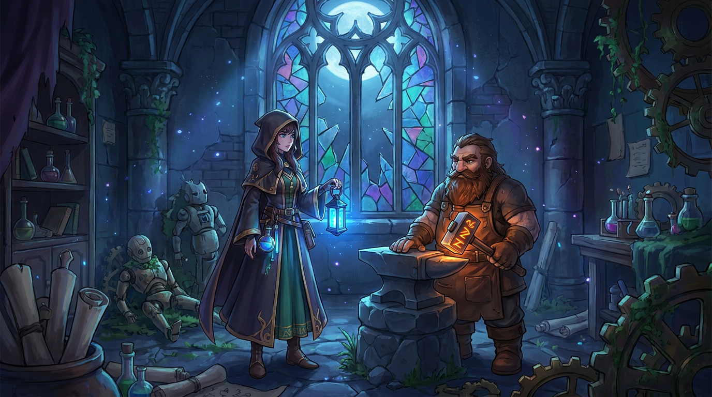
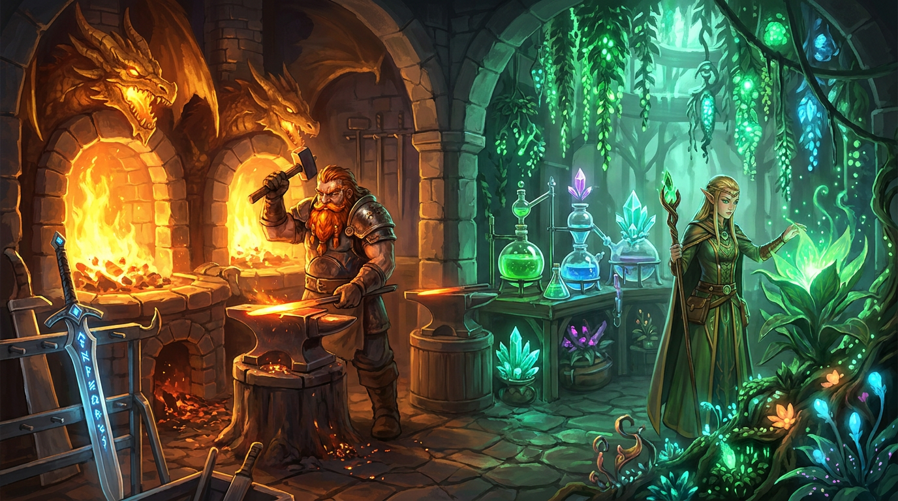
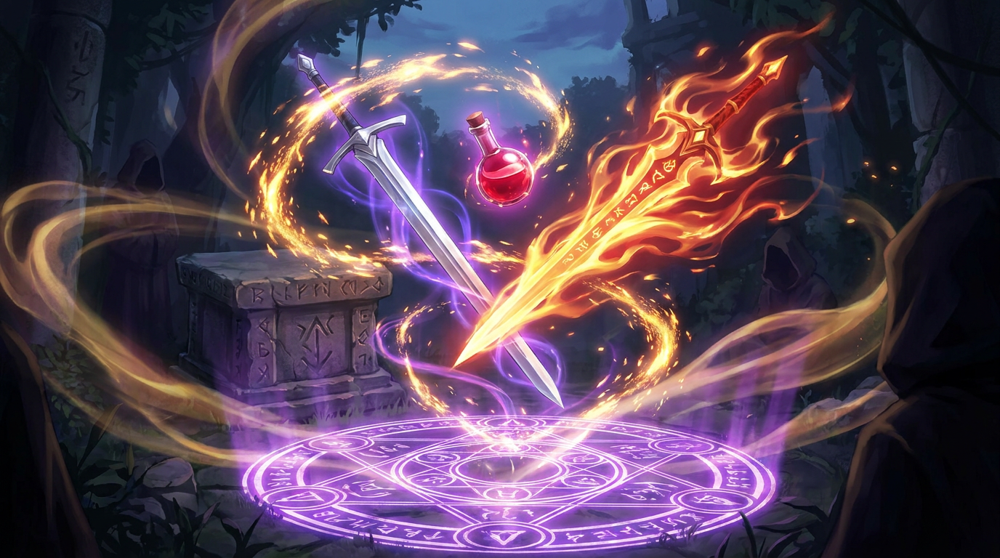

# ⚒️ Arcane Forge: Merge & Restore (아케인 포지: 마법 공방 복구기)

<p align="center">
  <a href="https://blackun.github.io/ArcaneForge/" target="_blank">
    
  </a>
</p>

> 🌐 **라이브 게임 실행 링크 (GitHub Pages)**: **[https://blackun.github.io/ArcaneForge/](https://blackun.github.io/ArcaneForge/)**  
> *(위 버튼 또는 링크를 클릭하면 별도 설치 없이 브라우저에서 즉시 게임이 실행됩니다!)*

> **10년 전 「검은 일식」으로 폐허가 된 천공의 마법 공방 〈아케인 포지〉를 되살려라!**  
> 7x7 그리드 드래그 앤 드롭 머지(Merge) · 이종 교차 연성(Cross-Crafting) · 보스 몬스터 토벌 · 비주얼 노벨 스토리가 결합된 판타지 웹 게임입니다.

---

## 🖼️ 스토리 & 캐릭터 일러스트 프리뷰

| 프롤로그: 검은 일식과 식어버린 모루 | 제1~2장: 화염의 대장간 & 연금술 온실 |
| :---: | :---: |
|  |  |

| 제3장: 고대 룬 제단과 이종 교차 연성 | 제4~5장: 비전 서고 & 에테르 천공 성소 |
| :---: | :---: |
|  |  |

| 견습 연금술사 리아 (Lia) | 드워프 마스터 대장장이 토르그 (Torg) |
| :---: | :---: |
|  |  |

---

## ✨ 주요 특징 (Key Features)

1. **🧩 7x7 그리드 머지 & 스마트 하이라이트**
   - 드래그 앤 드롭 및 클릭/탭 조작을 모두 지원합니다.
   - 아이템을 드래그할 때 **동일 아이템 머지 대상은 황금빛 오라**, **이종 교차 연성 대상은 회전하는 보라색 룬 마법진**으로 실시간 표시됩니다.
   - **크리티컬 머지(8% 확률, +2단계 점프)** 와 **럭키 드롭(15% 확률, 인접 빈 칸 보너스 생성)** 시스템이 짜릿한 손맛을 제공합니다.

2. **🔮 4대 이종 교차 연성 (Cross-Crafting)**
   - 대장간 무기·연금술 포션·고대 비전 마법 체인을 서로 결합해 전설의 하이브리드 아티팩트를 연성합니다.
   - `기사의 장검 (Lv.4)` + `화염의 영약 (Lv.5)` ➔ **🗡️ 홍련의 마검 (`hybrid_flameblade`)**
   - `미스릴 대검 (Lv.5)` + `각인된 룬석 (Lv.2)` ➔ **⚡ 뇌전의 룬검 (`hybrid_runeblade`)**
   - `고대 마도서 (Lv.4)` + `불사조의 비약 (Lv.6)` ➔ **📗 생명의 금서 (`hybrid_tome_of_life`)**
   - `정령의 보주 (Lv.5)` + `현자의 돌 (Lv.7)` ➔ **🌟 에테르 코어 (`hybrid_aether_core`)**

3. **⚔️ 보스 몬스터 전투 아레나 (Monster Combat)**
   - 머지한 **무기(검·도끼·창)**, **연금술 포션**, **고대 비전 마도서**, **이종 교차 연성 아티팩트**를 보드 밖 상단의 **보스 몬스터 카드에 직접 드래그 앤 드롭**하거나 `⚔️ 몬스터 공격` 버튼으로 투척해 토벌할 수 있습니다.
   - 구역별 5대 보스 몬스터(잿더미 용암 슬라임 ~ 검은 일식의 에테르 드래곤)마다 **약점 속성(1.5배 카운터)** 과 **특효 무기(일격필살 시그니처 보너스)** 가 존재합니다.

4. **📜 6부작 비주얼 노벨 스토리 & 한국어 음성 내레이션 + 프로시저럴 BGM**
   - 프롤로그 및 5개 챕터의 풀 보이스 비주얼 노벨 컷신과 선택지 분기 시스템을 탑재했습니다.
   - 외부 오디오 파일 없이 **Web Audio API**로 실시간 합성되는 3종 판타지 BGM(`공방 테마` / `스토리 오르골 테마` / `보스 전투 테마`)과 **Web Speech API** 기반의 자연스러운 한국어 성우 내레이션을 지원합니다.

5. **🏰 5대 마법 공방 구역 복구 & 월드맵**
   - 15단계 복구 퀘스트를 달성할 때마다 `화염의 대장간`, `연금술 온실`, `마법 부여 제단`, `고대 비전 서고`, `천공의 에테르 성소`가 폐허(0단계)에서 전설의 마스터피스(3단계)로 진화합니다.

---

## 🚀 실행 및 빌드 방법 (Getting Started)

외부 npm 런타임 패키지 의존성이 없는 **Zero-Dependency 순수 TypeScript + 번들 아키텍처**로 설계되어 있어, 클론 즉시 실행하거나 빌드할 수 있습니다.

### 1. 로컬 웹 서버 실행 (권장)
```bash
node scripts/serve.mjs 5147
# 또는
npm start
```
브라우저에서 **`http://127.0.0.1:5147`** 에 접속하면 즉시 플레이할 수 있습니다.

### 2. 정적 파일 직접 실행
`dist/bundle.js`에 모든 컴파일된 코드가 포함되어 있어, `index.html` 파일을 브라우저에서 직접 열거나 GitHub Pages 등 정적 호스팅에 그대로 배포해도 동작합니다.

### 3. 소스코드 수정 후 빌드 & 자동 무결성 검증
```bash
npm run build
# 내부적으로 node scripts/build-and-verify.mjs 실행
```
- `src/**/*.ts` 파일들을 `dist/**/*.js` 및 단일 브라우저 번들 `dist/bundle.js`로 컴파일합니다.
- 빌드 직후 **44종 아이템 체인, 4종 이종 교차 연성 레시피, 15개 복구 퀘스트, 5종 보스 몬스터 데미지 공식, 스토리/초상화 이미지 파일 경로 무결성**을 자동으로 검증합니다.

---

## 📂 디렉터리 구조 (Project Structure)

```text
ArcaneForge/
├── index.html                  # 메인 엔트리 HTML
├── package.json                # 빌드 및 로컬 서버 실행 스크립트
├── tsconfig.json               # TypeScript 설정
├── assets/
│   └── story/                  # 스토리 챕터 배경 일러스트(4종) & 캐릭터 초상화(2종)
├── src/                        # TypeScript 원본 소스코드
│   ├── types.ts                # 핵심 데이터 인터페이스 정의
│   ├── main.ts                 # 메인 게임 엔진, 7x7 그리드, 전투·스토리·도감 UI 컨트롤러
│   ├── style.css               # 다크 아케인 판타지 글래스모피즘 스타일시트
│   ├── data/
│   │   ├── items.ts            # 44종 아이템 정의, 인라인 SVG 아이콘, 4종 교차 연성 레시피
│   │   ├── quests.ts           # 5대 공방 구역 및 15단계 복구 퀘스트 데이터
│   │   ├── story.ts            # 프롤로그 + 5대 챕터 비주얼 노벨 대사·선택지·동료 대사
│   │   └── monsters.ts         # 5대 보스 몬스터 스탯·약점·전투 데미지 계산 공식
│   ├── systems/
│   │   ├── audio.ts            # Web Audio 프로시저럴 BGM·효과음 & 한국어 TTS 내레이션 엔진
│   │   └── particles.ts        # Canvas 2D 60fps 파티클 & 플로팅 텍스트 연출 시스템
│   └── views/
│       └── worldmap.ts         # 5대 공방 구역별 4단계(총 20종) 복구 전/후 SVG 일러스트 렌더러
├── dist/                       # 빌드 결과물 (ES 모듈 및 단일 브라우저 번들)
│   └── bundle.js               # 즉시 실행 가능한 통합 번들 파일
├── scripts/
│   ├── build-and-verify.mjs    # TypeScript 트랜스파일러 + 번들러 + 무결성 자동 검증기
│   └── serve.mjs               # 캐시 방지 헤더가 적용된 경량 로컬 HTTP 서버
└── docs/                       # 상세 기획 및 아키텍처 문서
    ├── GAME_GUIDE.md           # 아이템 체인·교차 연성·몬스터 공략 가이드
    └── ARCHITECTURE.md         # 기술 아키텍처 및 모듈 설계 문서
```

---

## 📚 상세 문서 (Documentation)

- **[게임 플레이 & 공략 가이드 (`docs/GAME_GUIDE.md`)](./docs/GAME_GUIDE.md)**: 44종 전체 아이템 티어표, 4대 이종 교차 연성 비법, 5대 보스 몬스터 약점 공략, 치트 툴바 사용법 안내
- **[기술 아키텍처 문서 (`docs/ARCHITECTURE.md`)](./docs/ARCHITECTURE.md)**: 코어 머지 엔진, Web Audio 프로시저럴 사운드 합성기, 한국어 자연어 TTS 파이프라인, 빌드 및 검증 구조 설명
