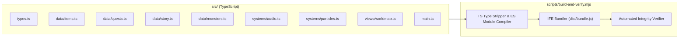

# 🏗️ Arcane Forge: 기술 아키텍처 및 모듈 설계 문서

## 1. 아키텍처 개요

**《Arcane Forge: Merge & Restore》** 는 외부 프레임워크나 무거운 번들러에 의존하지 않는 **Zero-Dependency 순수 TypeScript 아키텍처**로 설계되었습니다.
Node.js 내장 `stripTypeScriptTypes` API를 활용하는 커스텀 빌드 파이프라인(`scripts/build-and-verify.mjs`)을 통해:
1. 개별 ES 모듈(`dist/**/*.js`) 생성
2. 단일 IIFE 브라우저 번들(`dist/bundle.js`) 생성
3. 데이터 및 로직 무결성 자동 검증 테스트 수행

이 세 가지를 단 1초 내에 동시에 처리합니다.

---

## 2. 모듈별 상세 역할

### 2.1 데이터 계층 (`src/data/`)
- **`items.ts`**: 44종 아이템의 메타데이터(카테고리, 레벨, 스폰 확률 테이블, 판매 가격, 설명)와 고밀도 인라인 SVG 아이콘(`viewBox="0 0 64 64"`), 그리고 4종의 이종 교차 연성(`CROSS_CRAFT_RECIPES`) 양방향 탐색 함수(`findCrossCraftRecipe`)를 제공합니다.
- **`quests.ts`**: 5대 마법 공방 구역(`WORKSHOP_ZONES`) 및 15단계 복구 퀘스트(`QUESTS`), 납품 완료 시 재생되는 리아·토르그의 스토리 대사를 정의합니다.
- **`story.ts`**: 프롤로그 + 5개 메인 챕터의 비주얼 노벨 대사, 감정 태그, 선택지 분기(`optionA` / `optionB`), 동료 배너 대사(`COMPANION_CHATTER`), 그리고 캐릭터 초상화 매핑(`getCharacterPortrait`)을 관리합니다.
- **`monsters.ts`**: 5종 보스 몬스터의 체력, 약점 속성, 특효 아이템, 커스텀 다크 판타지 SVG 일러스트, 그리고 아이템 카테고리·레벨·상성에 따른 데미지 계산 함수(`calculateItemDamage`)를 제공합니다.

### 2.2 연출 및 오디오 시스템 계층 (`src/systems/`)
- **`audio.ts` (`SoundSystem`)**:
  - **효과음(SFX)**: Web Audio API 오실레이터(`sine`, `triangle`, `sawtooth`)와 밴드패스 노이즈 버스트를 조합하여 머지 콤보 음계 상승, 이종 교차 연성 아르페지오, 검 참격음, 포션 파열음, 몬스터 토벌 팡파레를 합성합니다.
  - **배경음악(BGM)**: 3가지 테마(`workshop`, `story`, `battle`)를 실시간 스케줄링 루프로 연주합니다.
  - **자연스러운 한국어 음성 내레이션(TTS)**: Web Speech API에서 구형 기계음(Eloquence 포먼트 음성 등)을 자동 필터링하고, 클라우드 신경망 음성(`Neural` / `Natural` / `Google 한국의`) 및 고품질 한국어 성우(`Yuna`)를 우선 선택하며, 문장 호흡 분리 및 자연스러운 피치 범위(`0.93 ~ 1.05`)로 대사를 낭독합니다.
- **`particles.ts` (`ParticleSystem`)**:
  - 전체 화면 오버레이 `<canvas>` 위에서 60fps `requestAnimationFrame` 루프로 동작합니다.
  - 일반 머지 스파크, 교차 연성 나선형 룬 입자, 공방 복구 황금 불꽃, 몬스터 참격/폭발 이펙트 및 플로팅 텍스트를 렌더링합니다.

### 2.3 뷰 및 코어 컨트롤러 (`src/views/`, `src/main.ts`)
- **`views/worldmap.ts`**: 5개 공방 구역 각각에 대해 복구 단계(`stage 0 ~ 3`)에 따라 시각적으로 진화하는 총 20종의 대형 SVG 배경 일러스트와 캐릭터 SVG 폴백 초상화를 렌더링합니다.
- **`main.ts` (`ArcaneForgeGame`)**:
  - 7x7 그리드(49칸) 및 인벤토리 슬롯의 상태 관리와 `localStorage` 자동 저장을 담당합니다.
  - Pointer Events(`pointerdown`, `pointermove`, `pointerup`) 기반의 커스텀 드래그 고스트(Ghost) 및 타겟 하이라이트(`merge`, `crosscraft`, `monster-target`, `storage`)를 처리합니다.
